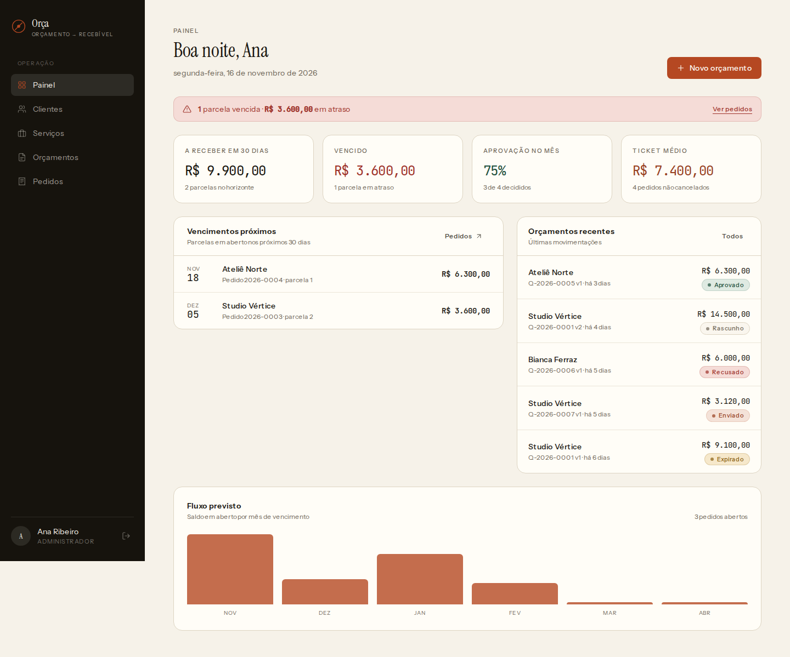
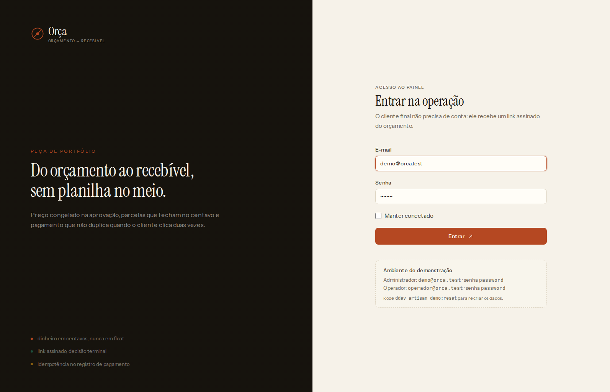
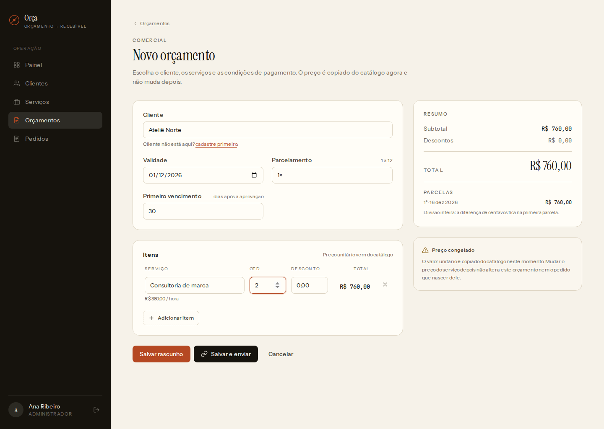
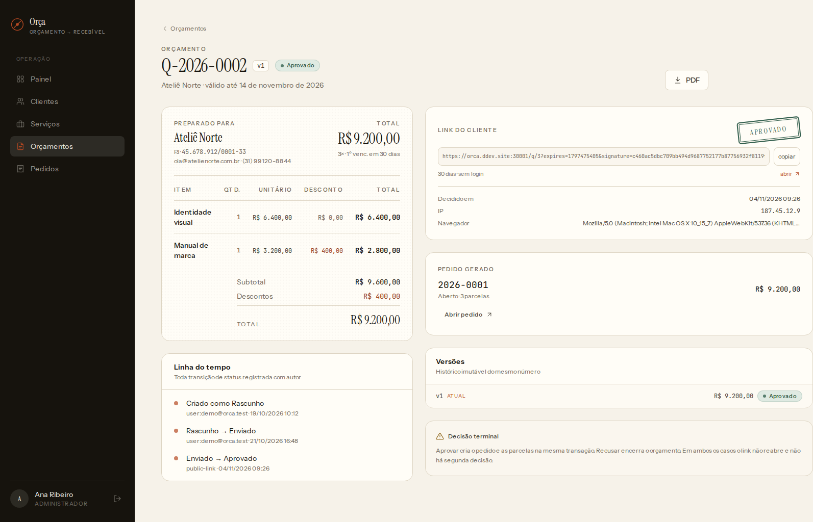
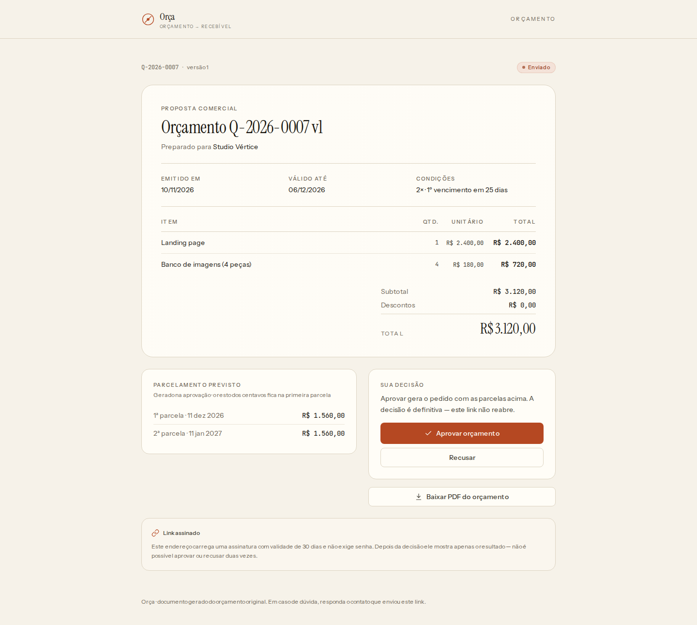
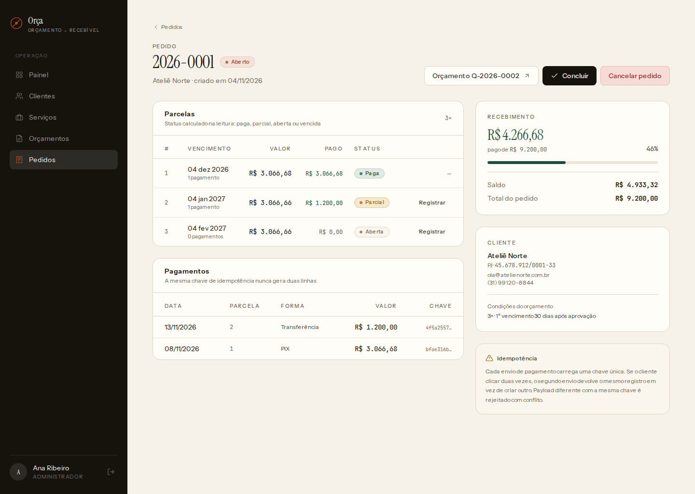

# Orça — do orçamento ao recebível

Sistema de gestão para prestador de serviço que ainda fecha negócio por planilha. Cobre o
ciclo comercial curto que toda operação pequena repete:

**orçamento versionado → aprovação por link assinado → pedido → parcelas → pagamento.**

Laravel 13 · Livewire 4 · PostgreSQL 16 · Pest · Playwright · DDEV.



## Os cinco invariantes

| Invariante | Onde está implementado | Como é provado |
|---|---|---|
| Dinheiro em inteiro, sem float | `app/Domain/Money.php` | `tests/Unit/MoneyTest.php` (divisão de 1000,00 em 3×/7×/11×) |
| Preço congelado na aprovação | snapshot em `quotation_items.unit_price_cents` | `QuotationLifecycleTest`: catálogo muda depois, pedido não muda |
| Pagamento idempotente | `UNIQUE (receivable_id, idempotency_key)` + `PaymentService` | mesma chave 2× devolve o mesmo registro; payload diferente → 409 |
| Link público assinado, decisão terminal | `URL::temporarySignedRoute` (30 dias) + `QuotationService::decide` | assinatura expirada → 403; segunda decisão → conflito |
| Permissão que nega | `app/Policies/*` + `Role` (`admin`, `operator`) | operador não arquiva cliente nem altera preço de catálogo |

Invariantes também no banco, não só na aplicação: `CHECK` de valores positivos, total do item
(`quantity × unit − discount`), total do orçamento e índice único de pedido por orçamento.

## Como rodar

Pré-requisitos: Docker + [DDEV](https://ddev.com).

```bash
git clone <repo> orca && cd orca
ddev start
ddev composer install
cp -n .env.example .env && ddev artisan key:generate
ddev npm install && ddev npm run build
ddev artisan demo:reset
```

A URL é a que o DDEV informar em `ddev describe` (no ambiente de referência,
`https://orca.ddev.site:30001`, porque as portas 80/443 estavam ocupadas).

Login do demo:

| Papel | E-mail | Senha |
|---|---|---|
| Administrador | `demo@orca.test` | `password` |
| Operador | `operador@orca.test` | `password` |

`demo:reset` recria o dataset em ~1 s (medido em DDEV): 3 clientes, 8 serviços,
7 números de orçamento (8 versões, incluindo um expirado e um rascunho), 4 pedidos
e 9 parcelas — uma vencida, uma parcial e duas pagas.



## O que vale ver

- **Construtor de orçamento** (`/quotations/create`): itens com preço puxado do catálogo,
  desconto por item, totais e parcelamento calculados ao vivo.
- **Link do cliente**: o botão “Enviar ao cliente” gera uma URL assinada de 30 dias.
  A página pública não tem login; aprovar cria pedido e parcelas na mesma transação.
- **Pedido** (`/orders/{id}`): parcelas com status derivado na leitura (`paid`, `partial`,
  `overdue`, `open`), registro de pagamento com chave de idempotência e histórico que
  não duplica.
- **Painel**: a receber em 30 dias, vencido, taxa de aprovação do mês e ticket médio.

| | |
|---|---|
|  |  |
|  |  |

## Testes

```bash
ddev exec ./vendor/bin/pest          # 57 testes, inclui o reset do demo
npx playwright test                  # 2 fluxos contra o DDEV em execução
```

O Pest usa o banco `db_test`, criado automaticamente pelo hook `post-start` do DDEV.
O Playwright usa `ORCA_URL` para apontar para outra URL; por padrão
`https://orca.ddev.site:30001`.

## Estrutura

```
app/
  Domain/Money.php            # inteiro de centavos, divisão com resto na 1ª parcela
  Enums/                      # status de orçamento, recebível, pedido, método, papel
  Models/                     # Eloquent + casts; status de parcela é derivado
  Services/                   # QuotationService, OrderService, PaymentService
  Policies/                   # Customer, Service, Quotation, Order
  Livewire/                   # painel (dashboard, clientes, serviços, orçamentos, pedidos)
  Http/Controllers/           # link público (show/decide/pdf) e POST /payments
  Support/                    # PublicLink (URL assinada) e Sequence (nº por ano)
resources/views/
  layouts/                    # shell do painel e login
  components/                 # design system (ui/*) e layout público
  public/                     # proposta do cliente
  pdf/                        # layout de tabela compatível com dompdf
db/migrations/                # invariantes também no PostgreSQL
e2e/                          # Playwright: aprovação e pagamento repetido
```

## Decisões

- **Sem Filament.** O painel é Livewire + Tailwind próprios; o objetivo é mostrar domínio
  e interface, não configuração de framework.
- **Sem SPA.** Server-rendered com Livewire resolve o fluxo inteiro; não há API pública.
- **`POST /payments` interno** (sessão) para que 409/422 sejam reais e testáveis; o
  formulário do pedido posta nele com chave de idempotência.
- **Expiração é derivada** de `valid_until`; nunca existe `status = 'expired'` gravado.
- **Sinal de decisão:** IP e user agent são registrados no ato da aprovação/recusa.
- **`demo:reset`** recusa rodar com `APP_ENV=production`.

## Fora de escopo

NF-e, multi-tenant, contabilidade, conciliação bancária, boleto/PIX automático, app mobile,
portal do cliente além da página de aprovação e e-mail transacional real (o mailer fica em
`log`).
